<a href="https://akhilpadmanaban123.github.io/portfoliome/">
  
</a>

<p align="center">
  <a href="https://akhilpadmanaban123.github.io/portfoliome/"><b>Portfolio</b></a> ·
  <a href="https://www.linkedin.com/in/akhilpadmanaban/">LinkedIn</a> ·
  <a href="https://leetcode.com/u/akhilpadmanaban123/">LeetCode</a> ·
  <a href="https://www.youtube.com/@codewasepic9114">YouTube</a> ·
  <a href="https://medium.com/@codeitup1234">Medium</a> ·
  <a href="https://www.kaggle.com/akhilpadmanaban123">Kaggle</a> ·
  <a href="mailto:akhilpadmanaban123@gmail.com">Email</a>
</p>

I'm a software engineer at ICU Medical. I started in the C++ firmware of infusion pumps and moved to the AI team, where I design and build agents, RAG pipelines and chatbot backends end to end.

### What I'm building

- **A conversational package upload service.** A chatbot that lets clinicians push drug-library settings and software updates to infusion pumps. FastAPI, Ollama, LangChain, RAG, with session handling for concurrent users and a 1,500-case test suite.
- **A codebase agent.** A local Qwen coder model with tools to look up functions and classes, read them, and trace callers and callees across a C++ codebase, backed by Cognee graph memory.
- **Log analysis with RAG.** Root-causing power and battery issues across 100K–300K lines of device logs, using Drain3 template mining and LanceDB.

### Selected repositories

| Project | What it is | Stack |
| --- | --- | --- |
| [InfusionDeviceLogAnalyser](https://github.com/akhilpadmanaban123/InfusionDeviceLogAnalyser) | Log analysis agent for critical power events in embedded devices | Python · Qwen · Drain3 · LanceDB |
| [LanceDBExplore](https://github.com/akhilpadmanaban123/LanceDBExplore) | Hands-on exploration of vector databases | Python · LanceDB |
| [QwenBasicTrain](https://github.com/akhilpadmanaban123/QwenBasicTrain) | Training a small Qwen model for sentiment analysis | Python · Jupyter |
| [PremierLeaguePredictor](https://github.com/akhilpadmanaban123/PremierLeaguePredictor) | ML models that predict Premier League outcomes | Python · Jupyter |
| [BankVisionAI](https://github.com/akhilpadmanaban123/BankVisionAI) | Natural-language customer lookups for a banking portal | Python · Gemini |
| [reclaim-app](https://github.com/akhilpadmanaban123/reclaim-app) | App that helps people quit smoking and drinking | Dart · Flutter |
| [fortun0](https://github.com/akhilpadmanaban123/fortun0) | Financial management with AI-based planning | Kotlin |

### Toolkit

```text
AI & LLM      AI agents · LangGraph · LangChain · RAG · function calling · Ollama · Cognee · local LLMs (Qwen)
Languages     Python · C++ · SQL · Bash · C#/.NET (working)
Backend       FastAPI · Flask · Redis · PostgreSQL · MongoDB · LanceDB
Engineering   Pytest · Docker · Jenkins · Git · Linux · state machines · concurrency
```

### Recognition

- Smart India Hackathon: **Grand Finalist**, top 5 of 500 submissions (2023)
- Hack-n-Lead National Hackathon: **2nd prize** of 52 teams (2023)
- Codathon, AMC2 Coding Club: **1st prize** of 36 teams (2023)

<p align="center"><sub>The full story, with a 3D scene and an agent you can question, is on <a href="https://akhilpadmanaban123.github.io/portfoliome/">my portfolio</a>.</sub></p>
